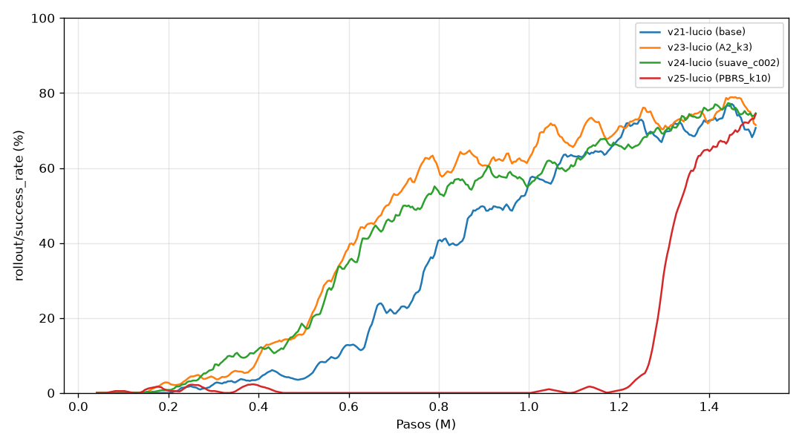
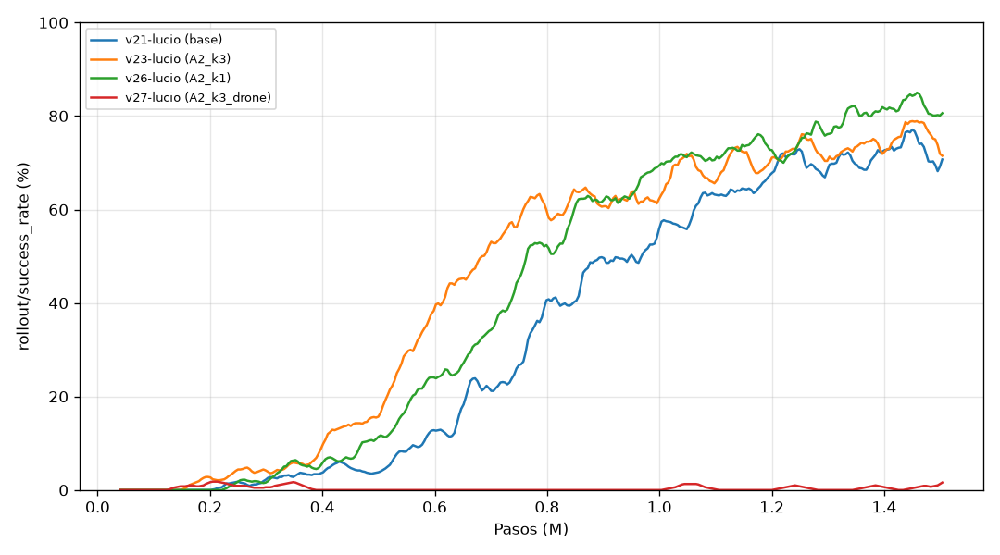

# Reporte: pruebas de recompensa (2026-10-15)

Rama `pruebas-recompensas` (sin pushear). Trabajo autónomo mientras Lucio no estaba.
Este archivo se va actualizando a medida que terminan las corridas; la sección **Conclusiones** está al final.

## Qué se quería responder

1. ¿Es cierto que la recompensa más simple (`base`: `−0.1·d − 0.01` por paso, +25 al aterrizar, −10 al chocar)
   es la mejor? En particular, ¿por qué el término de progreso (A1/A2, v18/v19) empeoró todo, cuando en teoría
   debería ayudar?
2. ¿Penalizar el cambio de acción (`−c·Σ(a − a_anterior)²`) hace la política más suave, y a qué costo?
3. Otras ideas para atacar el modo de fallo de `base` (choque contra el borde bajando en diagonal).

## Cambios en el código

- `env.py`: términos nuevos, todos apagados por defecto (así `base` y las variantes viejas dan lo mismo que antes):
  - `reward_progress_mode: drone`: el progreso mide solo lo que se movió el dron (las dos distancias contra el tope
    **actual** de la plataforma). Con el modo de siempre (`total`), `d` cambia aunque el dron no haga nada, porque
    la plataforma se mueve (hasta 0.3 m/s = 1.25 cm por paso).
  - `reward_pbrs_coef`: shaping por potencial "de libro" (Ng et al. 1999): `γ·Φ(s') − Φ(s)`, con `Φ = −k·d` y
    `Φ = 0` en estados terminales. Es el único shaping que garantiza no cambiar la política óptima.
  - `reward_action_coef`: `−c·Σ(a − a_anterior)²` (lo que estaba comentado en `_computeReward`).
  - `reward_edge_coef`: castigo por estar afuera del radio de la plataforma y a menos de 15 cm del tope.
  - `prev_d` en el `reset` ahora se mide contra el tope y no contra el centro de la plataforma (no cambiaba nada:
    el progreso del primer paso no se cuenta).
- `rewards.yaml`: variantes nuevas (ver la tabla de corridas).
- `train.py`: `--run_id` para lanzar varias corridas en paralelo sin que saquen el mismo número.
- `tools/evaluate.py`: guarda `smoothness` en `eval_*.json`: cambio medio de la acción por paso
  (`action_change`, lo mismo que castiga `reward_action_coef`), cambio de la velocidad pedida por paso
  (`cmd_vel_change`, m/s) y aceleración media del dron (`drone_accel`, m/s²). Reevaluado v21 con esto (mismos
  resultados de éxito).

## Un hallazgo teórico antes de entrenar: el "progreso" de A1/A2 no es shaping por potencial

El progreso que se usaba es `k·(d_anterior − d)`. El shaping por potencial con `Φ = −k·d` es
`γΦ(s') − Φ(s) = k·(d_anterior − γ·d) = k·(d_anterior − d) + (1−γ)·k·d`. O sea:

`progreso = PBRS − (1−γ)·k·d` → con k = 10 y γ = 0.99, **progreso = PBRS − 0.1·d**.

Consecuencias:
- **A1** (progreso k=10 sin distancia) es PBRS + el mismo `−0.1·d` de `base`, salvo en el paso terminal: ahí PBRS
  da `+k·d_anterior` (Φ = 0) y el progreso da `k·(d_anterior − d_final)`, o sea `−k·d_final` de diferencia. Así
  que **A1 = `base` + PBRS + un castigo extra de `10·d_final` al terminar** (≈ −4 al chocar contra el piso, ≈ 0 al
  aterrizar). En teoría tiene casi la misma política óptima que `base`; y aun así no aprendió (v18). La diferencia
  está en cómo aprende, no en qué es óptimo.
- **A2** (progreso k=10 + distancia) es **`base` con el doble de castigo por distancia** + PBRS. No es "base + una
  ayuda", cambia la recompensa.
- El PBRS bien hecho, sumado a `base`, **cancela** en promedio el `−0.1·d` por paso (aporta `+0.1·d`), así que
  el agente deja de tener apuro por terminar, como pasó con A1 y con XY. La teoría dice que la política óptima es
  la misma, pero el aprendizaje puede ser otro. Por eso se prueba (`PBRS_k10`, `PBRS_k3`).

## Corridas

Todas con los hiperparámetros de v21 (PPO, 8 envs, 1.5M pasos), comparadas contra `base`. Se corren 3 a la vez,
así que tardan ~1.5–2 h cada tanda. La evaluación es de 100 episodios del best (seeds 42–141, las mismas para todas).

Columnas: éxito en el entrenamiento (`rollout/success_rate`, **con la política estocástica**, promedio de los
últimos 100k pasos antes de cada punto), primer paso en que cruza 50 %, en qué paso estuvo el best, evaluación
de 100 episodios del best (determinista) y suavidad (cambio medio por paso de la acción y de la velocidad pedida,
más chico = más suave), y lo mismo para el modelo final a 1.5M. Tabla generada con `python -m tools.compare_runs ...`.

### Tanda 1 (seed 42)

| Run | Recompensa | Seed | Éxito entr. 0.5M / 1M / 1.5M | Cruza 50 % | Best a | Éxito best (100 ep.) | Choque plat. / piso / tiempo | Aterriza (s) | Δacción | Δv pedida (m/s) | Éxito final (100 ep.) | Δacción final | Δv pedida final |
|---|---|---|---|---|---|---|---|---|---|---|---|---|---|
| v21-lucio | `base` | 42 | 5% / 52% / 73% | 0.86M | 0.9M | 65% (55–74) | 31 / 3 / 1 | 2.42 | 0.51 | 0.216 | 72% | 0.79 | 0.259 |
| v23-lucio | `A2_k3` | 42 | 15% / 63% / 76% | 0.62M | 1.4M | 75% (66–82) | 25 / 0 / 0 | 2.33 | 0.86 | 0.272 | 64% | 0.83 | 0.267 |
| v24-lucio | `suave_c002` | 42 | 14% / 57% / 75% | 0.63M | 1.4M | 67% (57–75) | 26 / 2 / 5 | 2.38 | 0.20 | 0.119 | 72% | 0.26 | 0.133 |
| v25-lucio | `PBRS_k10` | 42 | 0% / 0% / 70% | 1.31M | 1.5M | 69% (59–77) | 30 / 0 / 0 | 2.46 | 1.46 | 0.360 | 72% | 1.47 | 0.358 |

Lectura:
- **`A2_k3` (progreso k=3 + distancia):** con k chico el progreso ya no rompe nada (con k=10, v19, no aprendía).
  Aprende más rápido que `base` (cruza 50 % a 0.62M contra 0.86M) y el best es algo mejor (75 % contra 65 %),
  aunque los intervalos se pisan. Es un poco **menos suave** que `base`.
- **`suave_c002` (castigo `0.02·Σ(Δa)²`):** mismo éxito que `base`, también aprende antes, y es **mucho más
  suave**: el cambio de acción por paso baja de 0.51 a 0.20 (−60 %) y el de la velocidad pedida de 0.22 a 0.12 m/s
  (−45 %). La aceleración real del dron casi no cambia (1.64 contra 1.77 m/s²): el PID del dron ya filtra parte de
  los saltos de la acción. Hay 5 episodios por tiempo (contra 1).
- **`PBRS_k10`:** confirma lo que se esperaba de la teoría: el PBRS cancela el apuro por terminar y el agente
  flota sin bajar hasta 1.2M pasos. Pero después aprende de golpe (de 2 % a 70 % entre 1.2M y 1.5M) y el best
  queda en 69 %, igual que `base`. O sea que **A1 (v18) probablemente también hubiera aprendido con más pasos**:
  1.5M no alcanzaba para verlo. Es la variante menos suave.
- **El best engaña: con los modelos finales (1.5M, 100 episodios) las cuatro dan casi lo mismo** (`base` 72 %,
  `A2_k3` 64 %, `suave_c002` 72 %, `PBRS_k10` 72 %). El best se elige con 8 episodios, así que el que se guarda
  depende mucho de la suerte: el de v21 (65 %) es peor que su modelo final (72 %), y el de v23 (75 %) mejor que el
  suyo (64 %). **En éxito, ninguna variante le gana a `base` con una seed.** Lo que sí es claro es la
  suavidad: comparando los finales, `suave_c002` cambia la acción 3 veces menos que `base` (0.26 contra 0.79).
- Ojo: a 1.5M la seed 42 de `base` puede haber sido lenta. Por eso van `base` con seeds 1 y 2, y `A2_k3` y
  `suave_c002` con las mismas seeds.

### Tanda 2: más variantes de progreso (seed 42)

| Run | Recompensa | Seed | Éxito entr. 0.5M / 1M / 1.5M | Cruza 50 % | Best a | Éxito best (100 ep.) | Choque plat. / piso / tiempo | Aterriza (s) | Δacción | Δv pedida (m/s) | Éxito final (100 ep.) | Δacción final | Δv pedida final |
|---|---|---|---|---|---|---|---|---|---|---|---|---|---|
| v21-lucio | `base` | 42 | 5% / 52% / 73% | 0.86M | 0.9M | 65% (55–74) | 31 / 3 / 1 | 2.42 | 0.51 | 0.216 | 72% | 0.79 | 0.259 |
| v23-lucio | `A2_k3` | 42 | 15% / 63% / 76% | 0.62M | 1.4M | 75% (66–82) | 25 / 0 / 0 | 2.33 | 0.86 | 0.272 | 64% | 0.83 | 0.267 |
| v26-lucio | `A2_k1` | 42 | 9% / 66% / 82% | 0.74M | 1.2M | 66% (56–74) | 24 / 3 / 7 | 2.4 | 1.07 | 0.309 | 74% | 0.98 | 0.296 |
| v27-lucio | `A2_k3_drone` | 42 | 0% / 0% / 1% | nunca | 0.2M | 35% (26–45) | 48 / 2 / 14 | 2.42 | 0.11 | 0.088 | 2% | 3.11 | 0.555 |

- **`A2_k1`:** como `A2_k3`: aprende antes que `base` (0.74M) y tiene el éxito de entrenamiento más alto a 1.5M
  (82 %), pero en 100 episodios el final da 74 %, igual que `base`. Y es menos suave.
- **`A2_k3_drone` (progreso sin el "ruido" de la plataforma): falla, y por una razón que vale la pena entender.**
  Aprendió a aterrizar a 0.2M (62 % en la eval de 8 episodios) y después lo abandonó: al final, 86 de 100 episodios
  terminan por tiempo, flotando. El progreso "solo del dron" ya **no es una suma telescópica**: si el dron
  persigue a la plataforma a distancia fija, en cada paso "se acerca" a donde está ahora la plataforma, y cobra
  progreso sin acercarse nunca. Simulado: perseguirla 40 cm por detrás durante un episodio da **+16** con este
  progreso y **0** con el `total`. Es un hackeo de la recompensa.
  **Conclusión: el "ruido" que mete la plataforma en el progreso `total` no es un defecto, es lo que hace que el
  término sea (casi) un potencial y no se pueda explotar.** No vale la pena "limpiarlo".

(se completa a medida que terminan)

## Conclusiones

(pendiente)
