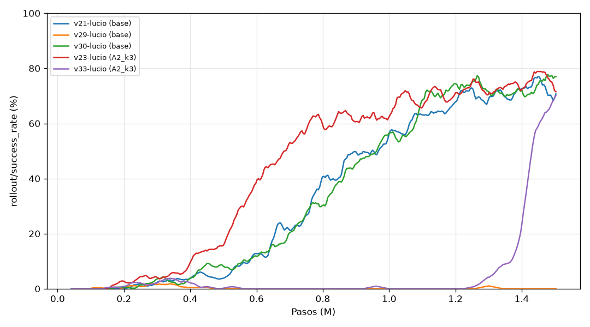
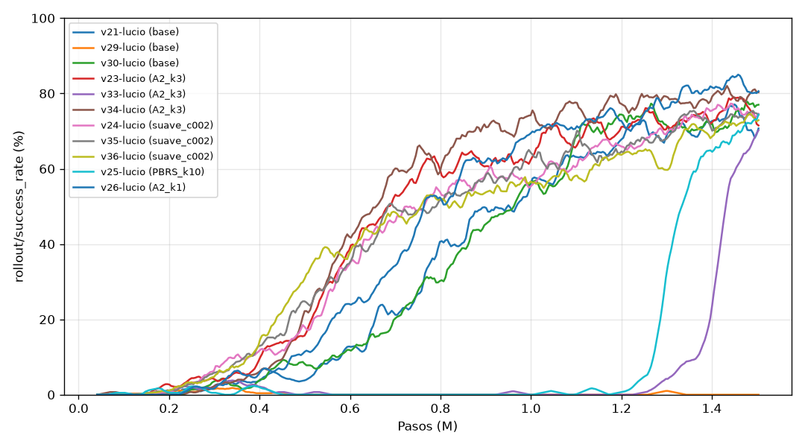
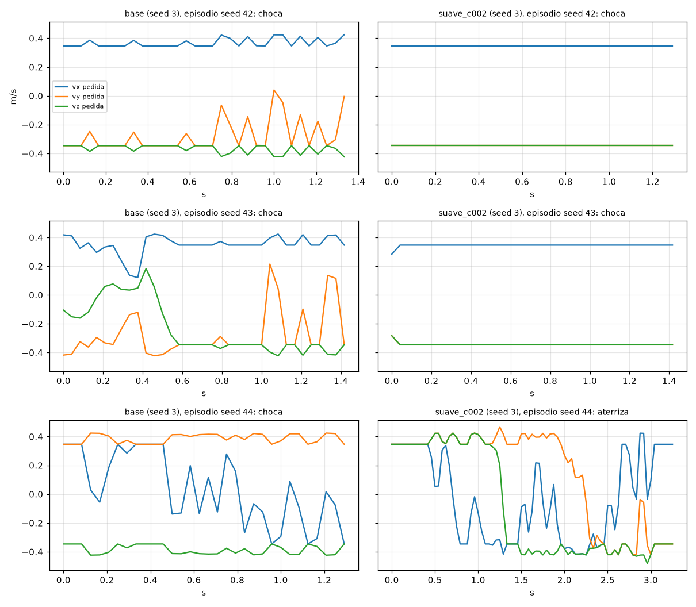
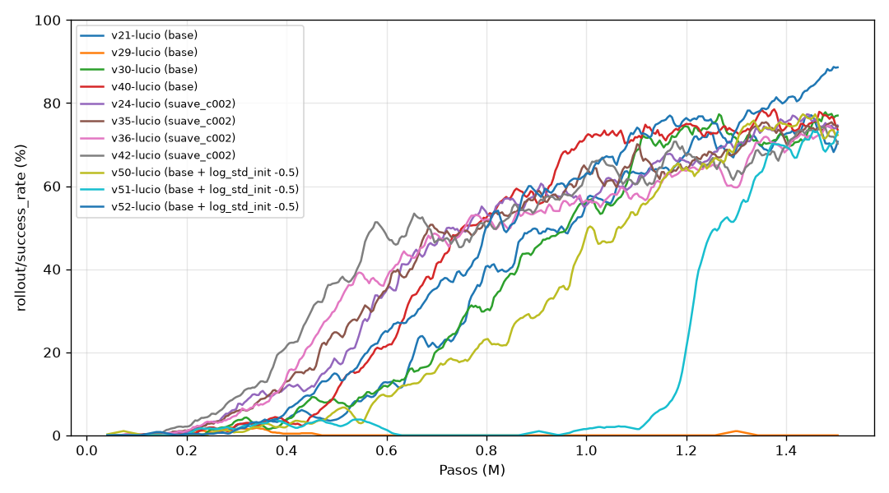

# Reporte: pruebas de recompensa (2026-10-15)

Rama `pruebas-recompensas` (sin pushear). Trabajo autónomo mientras Lucio no estaba.
Este archivo se va actualizando a medida que terminan las corridas; la sección **Conclusiones** está al final.

## Qué se quería responder

1. ¿Es cierto que la recompensa más simple (`base`: `−0.1·d − 0.01` por paso, +25 al aterrizar, −10 al chocar)
   es la mejor? En particular, ¿por qué el término de progreso (A1/A2, v18/v19) empeoró todo, cuando en teoría
   debería ayudar?
2. ¿Penalizar el cambio de acción (`−c·Σ(a − a_anterior)²`) hace la política más suave, y a qué costo?
3. Otras ideas para atacar el modo de fallo de `base` (choque contra el borde bajando en diagonal).

## Cambios en el código

- `env.py`: términos nuevos, todos apagados por defecto (así `base` y las variantes viejas dan lo mismo que antes):
  - `reward_progress_mode: drone`: el progreso mide solo lo que se movió el dron (las dos distancias contra el tope
    **actual** de la plataforma). Con el modo de siempre (`total`), `d` cambia aunque el dron no haga nada, porque
    la plataforma se mueve (hasta 0.3 m/s = 1.25 cm por paso).
  - `reward_pbrs_coef`: shaping por potencial "de libro" (Ng et al. 1999): `γ·Φ(s') − Φ(s)`, con `Φ = −k·d` y
    `Φ = 0` en estados terminales. Es el único shaping que garantiza no cambiar la política óptima.
  - `reward_action_coef`: `−c·Σ(a − a_anterior)²` (lo que estaba comentado en `_computeReward`).
  - `reward_edge_coef`: castigo por estar afuera del radio de la plataforma y a menos de 15 cm del tope.
  - `prev_d` en el `reset` ahora se mide contra el tope y no contra el centro de la plataforma (no cambiaba nada:
    el progreso del primer paso no se cuenta).
- `rewards.yaml`: variantes nuevas (ver la tabla de corridas).
- `train.py`: `--run_id` para lanzar varias corridas en paralelo sin que saquen el mismo número.
- `tools/evaluate.py`: guarda `smoothness` en `eval_*.json`: cambio medio de la acción por paso
  (`action_change`, lo mismo que castiga `reward_action_coef`), cambio de la velocidad pedida por paso
  (`cmd_vel_change`, m/s) y aceleración media del dron (`drone_accel`, m/s²). Reevaluado v21 con esto (mismos
  resultados de éxito).

## Un hallazgo teórico antes de entrenar: el "progreso" de A1/A2 no es shaping por potencial

El progreso que se usaba es `k·(d_anterior − d)`. El shaping por potencial con `Φ = −k·d` es
`γΦ(s') − Φ(s) = k·(d_anterior − γ·d) = k·(d_anterior − d) + (1−γ)·k·d`. O sea:

`progreso = PBRS − (1−γ)·k·d` → con k = 10 y γ = 0.99, **progreso = PBRS − 0.1·d**.

Consecuencias:
- **A1** (progreso k=10 sin distancia) es PBRS + el mismo `−0.1·d` de `base`, salvo en el paso terminal: ahí PBRS
  da `+k·d_anterior` (Φ = 0) y el progreso da `k·(d_anterior − d_final)`, o sea `−k·d_final` de diferencia. Así
  que **A1 = `base` + PBRS + un castigo extra de `10·d_final` al terminar** (≈ −4 al chocar contra el piso, ≈ 0 al
  aterrizar). En teoría tiene casi la misma política óptima que `base`; y aun así no aprendió (v18). La diferencia
  está en cómo aprende, no en qué es óptimo.
- **A2** (progreso k=10 + distancia) es **`base` con el doble de castigo por distancia** + PBRS. No es "base + una
  ayuda", cambia la recompensa.
- El PBRS bien hecho, sumado a `base`, **cancela** en promedio el `−0.1·d` por paso (aporta `+0.1·d`), así que
  el agente deja de tener apuro por terminar, como pasó con A1 y con XY. La teoría dice que la política óptima es
  la misma, pero el aprendizaje puede ser otro. Por eso se prueba (`PBRS_k10`, `PBRS_k3`).

## Corridas

Todas con los hiperparámetros de v21 (PPO, 8 envs, 1.5M pasos), comparadas contra `base`. Se corren 3 a la vez,
así que tardan ~1.5–2 h cada tanda. La evaluación es de 100 episodios del best (seeds 42–141, las mismas para todas).

Columnas: éxito en el entrenamiento (`rollout/success_rate`, **con la política estocástica**, promedio de los
últimos 100k pasos antes de cada punto), primer paso en que cruza 50 %, en qué paso estuvo el best, evaluación
de 100 episodios del best (determinista) y suavidad (cambio medio por paso de la acción y de la velocidad pedida,
más chico = más suave), y lo mismo para el modelo final a 1.5M. Tabla generada con `python -m tools.compare_runs ...`.

### Tanda 1 (seed 42)

| Run | Recompensa | Seed | Éxito entr. 0.5M / 1M / 1.5M | Cruza 50 % | Best a | Éxito best (100 ep.) | Choque plat. / piso / tiempo | Aterriza (s) | Δacción | Δv pedida (m/s) | Éxito final (100 ep.) | Δacción final | Δv pedida final |
|---|---|---|---|---|---|---|---|---|---|---|---|---|---|
| v21-lucio | `base` | 42 | 5% / 52% / 73% | 0.86M | 0.9M | 65% (55–74) | 31 / 3 / 1 | 2.42 | 0.51 | 0.216 | 72% | 0.79 | 0.259 |
| v23-lucio | `A2_k3` | 42 | 15% / 63% / 76% | 0.62M | 1.4M | 75% (66–82) | 25 / 0 / 0 | 2.33 | 0.86 | 0.272 | 64% | 0.83 | 0.267 |
| v24-lucio | `suave_c002` | 42 | 14% / 57% / 75% | 0.63M | 1.4M | 67% (57–75) | 26 / 2 / 5 | 2.38 | 0.20 | 0.119 | 72% | 0.26 | 0.133 |
| v25-lucio | `PBRS_k10` | 42 | 0% / 0% / 70% | 1.31M | 1.5M | 69% (59–77) | 30 / 0 / 0 | 2.46 | 1.46 | 0.360 | 72% | 1.47 | 0.358 |

Lectura:
- **`A2_k3` (progreso k=3 + distancia):** con k chico el progreso ya no rompe nada (con k=10, v19, no aprendía).
  Aprende más rápido que `base` (cruza 50 % a 0.62M contra 0.86M) y el best es algo mejor (75 % contra 65 %),
  aunque los intervalos se pisan. Es un poco **menos suave** que `base`.
- **`suave_c002` (castigo `0.02·Σ(Δa)²`):** mismo éxito que `base`, también aprende antes, y es **mucho más
  suave**: el cambio de acción por paso baja de 0.51 a 0.20 (−60 %) y el de la velocidad pedida de 0.22 a 0.12 m/s
  (−45 %). La aceleración real del dron casi no cambia (1.64 contra 1.77 m/s²): el PID del dron ya filtra parte de
  los saltos de la acción. Hay 5 episodios por tiempo (contra 1).
- **`PBRS_k10`:** confirma lo que se esperaba de la teoría: el PBRS cancela el apuro por terminar y el agente
  flota sin bajar hasta 1.2M pasos. Pero después aprende de golpe (de 2 % a 70 % entre 1.2M y 1.5M) y el best
  queda en 69 %, igual que `base`. O sea que **A1 (v18) probablemente también hubiera aprendido con más pasos**:
  1.5M no alcanzaba para verlo. Es la variante menos suave.
- **El best engaña: con los modelos finales (1.5M, 100 episodios) las cuatro dan casi lo mismo** (`base` 72 %,
  `A2_k3` 64 %, `suave_c002` 72 %, `PBRS_k10` 72 %). El best se elige con 8 episodios, así que el que se guarda
  depende mucho de la suerte: el de v21 (65 %) es peor que su modelo final (72 %), y el de v23 (75 %) mejor que el
  suyo (64 %). **En éxito, ninguna variante le gana a `base` con una seed.** Lo que sí es claro es la
  suavidad: comparando los finales, `suave_c002` cambia la acción 3 veces menos que `base` (0.26 contra 0.79).
- Ojo: a 1.5M la seed 42 de `base` puede haber sido lenta. Por eso van `base` con seeds 1 y 2, y `A2_k3` y
  `suave_c002` con las mismas seeds.

### Tanda 2: más variantes de progreso (seed 42)

| Run | Recompensa | Seed | Éxito entr. 0.5M / 1M / 1.5M | Cruza 50 % | Best a | Éxito best (100 ep.) | Choque plat. / piso / tiempo | Aterriza (s) | Δacción | Δv pedida (m/s) | Éxito final (100 ep.) | Δacción final | Δv pedida final |
|---|---|---|---|---|---|---|---|---|---|---|---|---|---|
| v21-lucio | `base` | 42 | 5% / 52% / 73% | 0.86M | 0.9M | 65% (55–74) | 31 / 3 / 1 | 2.42 | 0.51 | 0.216 | 72% | 0.79 | 0.259 |
| v23-lucio | `A2_k3` | 42 | 15% / 63% / 76% | 0.62M | 1.4M | 75% (66–82) | 25 / 0 / 0 | 2.33 | 0.86 | 0.272 | 64% | 0.83 | 0.267 |
| v26-lucio | `A2_k1` | 42 | 9% / 66% / 82% | 0.74M | 1.2M | 66% (56–74) | 24 / 3 / 7 | 2.4 | 1.07 | 0.309 | 74% | 0.98 | 0.296 |
| v27-lucio | `A2_k3_drone` | 42 | 0% / 0% / 1% | nunca | 0.2M | 35% (26–45) | 48 / 2 / 14 | 2.42 | 0.11 | 0.088 | 2% | 3.11 | 0.555 |

- **`A2_k1`:** como `A2_k3`: aprende antes que `base` (0.74M) y tiene el éxito de entrenamiento más alto a 1.5M
  (82 %), pero en 100 episodios el final da 74 %, igual que `base`. Y es menos suave.
- **`A2_k3_drone` (progreso sin el "ruido" de la plataforma): falla, y por una razón que vale la pena entender.**
  Aprendió a aterrizar a 0.2M (62 % en la eval de 8 episodios) y después lo abandonó: al final, 86 de 100 episodios
  terminan por tiempo, flotando. El progreso "solo del dron" ya **no es una suma telescópica**: si el dron
  persigue a la plataforma a distancia fija, en cada paso "se acerca" a donde está ahora la plataforma, y cobra
  progreso sin acercarse nunca. Simulado: perseguirla 40 cm por detrás durante un episodio da **+16** con este
  progreso y **0** con el `total`. Es un hackeo de la recompensa.
  **Conclusión: el "ruido" que mete la plataforma en el progreso `total` no es un defecto, es lo que hace que el
  término sea (casi) un potencial y no se pueda explotar.** No vale la pena "limpiarlo".

### Tanda 3: castigo por estar bajo y afuera (seed 42)

- **v28 `borde_k1`** (`−1·(d_xy − 0.25)₊·(0.15 − dz)₊/0.15` por paso): **0 % de éxito**, best y final; 96–97 de
  100 episodios terminan por tiempo. A 0.2–0.4M los episodios eran cortos (chocaba, como `base` al principio) y desde
  0.5M quedó flotando. Además es la política más brusca de todas (Δacción 2.37, aceleración 3.1 m/s²): oscila en el
  aire.
- Es la misma trampa que XY (v22), B (v20), A1 (v18) y `PBRS_k10` hasta 1.2M: **cualquier término que haga más caro
  bajar cerca de la plataforma, mientras el agente todavía no sabe aterrizar, lo lleva a no bajar nunca.** Como
  aterrizar con éxito es raro al principio, la recompensa de aterrizar no alcanza para compensar el castigo
  seguro de intentarlo. Se encola `borde_k02` (5 veces más suave) para ver si hay un punto intermedio.

### Tanda 4: otras seeds — `base` no es robusta

| Run | Recompensa | Seed | Éxito entr. 0.5M / 1M / 1.5M | Cruza 50 % | Best a | Éxito best (100 ep.) | Choque plat. / piso / tiempo | Aterriza (s) | Δacción | Δv pedida (m/s) | Éxito final (100 ep.) | Δacción final | Δv pedida final |
|---|---|---|---|---|---|---|---|---|---|---|---|---|---|
| v21-lucio | `base` | 42 | 5% / 52% / 73% | 0.86M | 0.9M | 65% (55–74) | 31 / 3 / 1 | 2.42 | 0.51 | 0.216 | 72% | 0.79 | 0.259 |
| v29-lucio | `base` | 1 | 0% / 0% / 0% | nunca | 0.2M | 10% (6–17) | 25 / 64 / 1 | 3.15 | 0.14 | 0.101 | 0% | 1.45 | 0.334 |
| v30-lucio | `base` | 2 | 8% / 52% / 75% | 0.87M | 1.2M | 74% (65–82) | 22 / 3 / 1 | 2.29 | 0.35 | 0.163 | 76% | 0.39 | 0.183 |
| v23-lucio | `A2_k3` | 42 | 15% / 63% / 76% | 0.62M | 1.4M | 75% (66–82) | 25 / 0 / 0 | 2.33 | 0.86 | 0.272 | 64% | 0.83 | 0.267 |
| v33-lucio | `A2_k3` | 1 | 0% / 0% / 62% | 1.40M | 1.4M | 64% (54–73) | 31 / 0 / 3 | 3.52 | 1.36 | 0.292 | 64% | 1.51 | 0.352 |

- **`base` con la seed 1 (v29) no aprende:** 0 % en el entrenamiento a 1.5M y el modelo final queda flotando (76 de
  100 episodios por tiempo). **Es la misma trampa en la que cayeron A1, B, XY y `borde_k1`, pero con la recompensa
  `base`.** O sea que esos fracasos, cada uno con una sola seed (42), no prueban que esas recompensas sean malas:
  `base` también puede caer. Hasta ahora todas las comparaciones del proyecto eran con la seed 42, que para
  `base` resultó ser una seed "buena".
- **`A2_k3` con la seed 1 (v33) sí sale de la trampa**, tarde (cruza 50 % a 1.4M), y termina en 64 %. Con dos
  seeds, `A2_k3` aprendió en las dos; `base`, en dos de tres.
- La suavidad también varía mucho con la seed (`base`: Δacción final 0.79 con la seed 42 y 0.39 con la 2). La
  comparación de suavidad hay que hacerla con varias seeds.
- **Cambio de plan:** la cola ahora prioriza más seeds (3 y 4) de `base`, `A2_k3` y `suave_c002`, y seeds 1 y 2
  de `PBRS_k10` y `A2_k1`, antes que variantes nuevas. La métrica principal pasa a ser **en cuántas seeds aprende**
  y el éxito medio entre seeds.

### Tanda 5: tres seeds de `base`, `A2_k3` y `suave_c002`

| Run | Recompensa | Seed | Éxito entr. 0.5M / 1M / 1.5M | Cruza 50 % | Best a | Éxito best (100 ep.) | Choque plat. / piso / tiempo | Aterriza (s) | Δacción | Δv pedida (m/s) | Éxito final (100 ep.) | Δacción final | Δv pedida final |
|---|---|---|---|---|---|---|---|---|---|---|---|---|---|
| v21-lucio | `base` | 42 | 5% / 52% / 73% | 0.86M | 0.9M | 65% (55–74) | 31 / 3 / 1 | 2.42 | 0.51 | 0.216 | 72% | 0.79 | 0.259 |
| v29-lucio | `base` | 1 | 0% / 0% / 0% | nunca | 0.2M | 10% (6–17) | 25 / 64 / 1 | 3.15 | 0.14 | 0.101 | 0% | 1.45 | 0.334 |
| v30-lucio | `base` | 2 | 8% / 52% / 75% | 0.87M | 1.2M | 74% (65–82) | 22 / 3 / 1 | 2.29 | 0.35 | 0.163 | 76% | 0.39 | 0.183 |
| v23-lucio | `A2_k3` | 42 | 15% / 63% / 76% | 0.62M | 1.4M | 75% (66–82) | 25 / 0 / 0 | 2.33 | 0.86 | 0.272 | 64% | 0.83 | 0.267 |
| v33-lucio | `A2_k3` | 1 | 0% / 0% / 62% | 1.40M | 1.4M | 64% (54–73) | 31 / 0 / 3 | 3.52 | 1.36 | 0.292 | 64% | 1.51 | 0.352 |
| v34-lucio | `A2_k3` | 2 | 15% / 72% / 80% | 0.62M | 1.4M | 81% (72–88) | 18 / 1 / 0 | 2.38 | 0.71 | 0.248 | 80% | 0.77 | 0.253 |
| v24-lucio | `suave_c002` | 42 | 14% / 57% / 75% | 0.63M | 1.4M | 67% (57–75) | 26 / 2 / 5 | 2.38 | 0.20 | 0.119 | 72% | 0.26 | 0.133 |
| v35-lucio | `suave_c002` | 1 | 20% / 61% / 74% | 0.66M | 1.2M | 72% (62–80) | 24 / 1 / 2 | 2.4 | 0.15 | 0.087 | 76% | 0.30 | 0.144 |
| v36-lucio | `suave_c002` | 2 | 26% / 56% / 73% | 0.66M | 1.4M | 74% (65–82) | 20 / 3 / 3 | 2.33 | 0.09 | 0.075 | 75% | 0.10 | 0.076 |

Por recompensa (seeds juntas; "aprendió" = el modelo final aterriza en ≥ 30 % de los 100 episodios):

| Recompensa | Seeds | Aprendieron | Éxito final por seed | Éxito final medio | Medio de las que aprendieron | Δacción final | Δv pedida final (m/s) |
|---|---|---|---|---|---|---|---|
| `base` | 3 | 2/3 | 0% (s1), 76% (s2), 72% (s42) | 49% | 74% | 0.59 | 0.221 |
| `A2_k3` | 3 | 3/3 | 64% (s1), 80% (s2), 64% (s42) | 69% | 69% | 1.04 | 0.291 |
| `suave_c002` | 3 | **3/3** | 76% (s1), 75% (s2), 72% (s42) | **74%** | 74% | **0.22** | **0.118** |

- **`suave_c002` es la mejor hasta ahora en todo:** aprendió en las 3 seeds (incluida la seed 1, donde `base` no
  aprendió), el éxito final es el más parejo (72–76 %), cruza el 50 % antes en todas (0.63–0.66M contra 0.86M,
  0.87M y nunca de `base`) y cambia la acción ~3 veces menos que `base`.
- **Hipótesis de por qué el castigo a la acción ayuda a aprender, y no solo a suavizar:** la condición de éxito
  pide 10 pasos seguidos apoyado con `|vz_rel| < 0.1` y roll/pitch < 0.1. Una política que salta de acción en
  acción hace que el dron se incline y rebote, y le cuesta cumplir eso; el castigo hace que el aterrizaje "por
  casualidad" (que es lo que el agente necesita al principio para descubrir el +25) pase más seguido. Además,
  castiga el ruido de exploración (la acción estocástica cambia mucho de paso a paso), así que la política reduce
  antes ese ruido. Se puede verificar mirando `train/std` en TensorBoard.
- **`A2_k3`** aprendió en las 3 seeds (más robusta que `base`) pero no es mejor en éxito (69 % medio) y es la
  menos suave de las tres.

### Tanda 6: seed 3

| Run | Recompensa | Seed | Éxito entr. 0.5M / 1M / 1.5M | Cruza 50 % | Best a | Éxito best (100 ep.) | Choque plat. / piso / tiempo | Aterriza (s) | Δacción | Δv pedida (m/s) | Éxito final (100 ep.) | Δacción final | Δv pedida final |
|---|---|---|---|---|---|---|---|---|---|---|---|---|---|
| v40-lucio | `base` | 3 | 7% / 68% / 75% | 0.72M | 1.5M | 74% (65–82) | 22 / 3 / 0 | 2.35 | 0.70 | 0.243 | 70% | 0.71 | 0.240 |
| v41-lucio | `A2_k3` | 3 | 0% / 0% / 8% | nunca | 0.3M | 32% (24–42) | 39 / 0 / 28 | 2.23 | 0.10 | 0.078 | 55% | 1.17 | 0.265 |
| v42-lucio | `suave_c002` | 3 | 32% / 60% / 73% | 0.55M | 1.5M | 74% (65–82) | 22 / 3 / 1 | 2.44 | 0.17 | 0.098 | 71% | 0.15 | 0.093 |

Acumulado con 4 seeds (1, 2, 3, 42):

| Recompensa | Seeds | Aprendieron | Éxito final por seed | Éxito final medio | Medio de las que aprendieron | Δacción final | Δv pedida final (m/s) |
|---|---|---|---|---|---|---|---|
| `base` | 4 | 3/4 | 0% (s1), 76% (s2), 70% (s3), 72% (s42) | 54% | 73% | 0.63 | 0.227 |
| `A2_k3` | 4 | 4/4 | 64% (s1), 80% (s2), 55% (s3), 64% (s42) | 66% | 66% | 1.07 | 0.284 |
| `suave_c002` | 4 | **4/4** | 76% (s1), 75% (s2), 71% (s3), 72% (s42) | **74%** | 74% | **0.20** | **0.112** |

- `suave_c002` sigue igual: 4 de 4, todas entre 71 y 76 %, y es la que antes cruza el 50 % en todas las seeds
  (0.55–0.66M).
- `A2_k3` con la seed 3 es otra "seed lenta": en el entrenamiento (política estocástica) llega a 8 %, pero la
  política determinista final ya aterriza en 55 %. Robusta (aprende siempre), pero lenta en algunas seeds y brusca.
- Cuando `base` aprende, llega a lo mismo que `suave_c002` (73 % contra 74 %). **La diferencia en éxito está en la
  robustez (en cuántas seeds aprende) y en la velocidad, no en el techo a 1.5M.**

### Hallazgo: las políticas son bang-bang y siempre bajan a velocidad máxima

Graficando la velocidad pedida en un episodio (`media/plots/accion_base_vs_suave.png`), las políticas casi no usan
valores intermedios: las componentes de la acción quedan pegadas a ±1. Medido en 20 episodios con el modelo final
(script en el scratchpad, `saturation.py`; "saturada" = |a| > 0.99 después del recorte):

| Corrida | `dx` sat. | `dy` sat. | **`dz` sat.** | `s` = 1 | Las 3 dir. saturadas | Media gaussiana de `dz` (mediana de \|μ\|) |
|---|---|---|---|---|---|---|
| v21 `base` s42 | 58 % | 62 % | **96 %** | 91 % | 35 % | 2.35 |
| v40 `base` s3 | 58 % | 55 % | **97 %** | 99 % | 29 % | 2.76 |
| v23 `A2_k3` s42 | 37 % | 48 % | **95 %** | 100 % | 23 % | 3.11 |
| v42 `suave_c002` s3 | 68 % | 69 % | **99 %** | 100 % | 47 % | 3.66 |

- **Todas bajan siempre, a velocidad máxima** (`s` = 1 casi siempre, `dz` = −1 en ~97 % de los pasos). Como la
  dirección se normaliza, el dron baja a entre 0.35 m/s (si se mueve en diagonal) y 0.6 m/s (si va derecho para
  abajo). **Nunca pide "quedarse a esta altura".** Por eso, si llega bajo y todavía afuera, choca el borde: es el
  modo de fallo de `base` que se vio en v17 y v21. No es un problema de pesos de la distancia (XY, `borde_k1`), es
  que la política aprendió una estrategia de "tirarse en picada y corregir en horizontal".
- La media de la gaussiana de `dz` está entre 2 y 4 (muy afuera de [−1, 1]). Es un problema conocido de PPO con
  acciones recortadas: más allá del borde todas las acciones dan lo mismo, así que la media se va lejos y la
  política deja de poder ajustar fino ese eje (habría que mover la media muchos desvíos para que cambie algo).
- **Relativiza la suavidad de `suave_c002`:** es más suave en parte porque se queda más pegada a las esquinas
  (47 % de los pasos con las 3 direcciones saturadas, contra ~30 % en `base`). Pasar de esquina a esquina sale
  caro, y la política aprendió a cambiar menos de esquina, no a usar acciones intermedias.
- Ideas que salen de esto (no son de la recompensa): una acción que sea directamente la velocidad
  (`v = 0.6·a`, sin normalizar la dirección), o aplastar la acción con `tanh` dentro del entorno, para que los
  valores intermedios sean naturales. Para la recompensa: castigar **bajar** mientras está afuera, en vez de
  castigar **estar** bajo y afuera (`borde_k1`, que llevó a no bajar nunca). Se prueba como `bajada_k1`.

### Tanda 7: control — `base` con menos ruido de exploración (sin tocar la recompensa)

Hipótesis de la tanda 5: `suave_c002` ayuda porque baja el ruido de exploración (`train/std` 0.89 contra 1.10 de
`base` a 0.25M). Un desvío de ~1 sobre acciones en [−1, 1] es mucho: la mitad de las acciones muestreadas cae
afuera del rango y se recorta. Control: `base` con `--log_std_init -0.5` (desvío inicial 0.61 en vez de 1).
`train.py` ahora acepta `--log_std_init` y `--ent_coef`.

| Run | Recompensa | Seed | Éxito entr. 0.5M / 1M / 1.5M | Cruza 50 % | Best a | Éxito best (100 ep.) | Choque plat. / piso / tiempo | Aterriza (s) | Δacción | Δv pedida (m/s) | Éxito final (100 ep.) | Δacción final | Δv pedida final |
|---|---|---|---|---|---|---|---|---|---|---|---|---|---|
| v50-lucio | `base + log_std_init -0.5` | 1 | 5% / 40% / 74% | 0.97M | 1.3M | 70% (60–78) | 25 / 1 / 3 | 2.38 | 0.20 | 0.139 | 79% | 0.46 | 0.216 |
| v51-lucio | `base + log_std_init -0.5` | 2 | 3% / 1% / 71% | 1.22M | 1.2M | 72% (62–80) | 26 / 0 / 0 | 2.79 | 0.36 | 0.166 | 76% | 0.36 | 0.179 |
| v52-lucio | `base + log_std_init -0.5` | 42 | 12% / 61% / 86% | 0.78M | 0.9M | 73% (64–81) | 23 / 1 / 2 | 2.58 | 0.23 | 0.160 | 81% | 0.33 | 0.186 |

| Recompensa | Seeds | Aprendieron | Éxito final por seed | Éxito final medio | Δacción final | Δv pedida final (m/s) |
|---|---|---|---|---|---|---|
| `base` | 4 | 3/4 | 0% (s1), 76% (s2), 70% (s3), 72% (s42) | 54% | 0.63 | 0.227 |
| `suave_c002` | 4 | 4/4 | 76% (s1), 75% (s2), 71% (s3), 72% (s42) | 74% | 0.20 | 0.112 |
| `base + log_std_init -0.5` | 3 | **3/3** | 79% (s1), 76% (s2), 81% (s42) | **79%** | 0.38 | 0.194 |

- **Confirmado: con menos ruido de exploración, `base` aprende en todas las seeds** (incluida la seed 1, que con
  desvío 1 quedaba flotando) **y llega al mejor éxito final hasta ahora: 79 % de media** (76–81 %).
- Aprende algo más lento que `suave_c002` (cruza 50 % a 0.78–1.22M contra 0.55–0.66M), pero termina más alto.
- Satura menos la acción: `dz` saturado en 85–86 % de los pasos (contra ~97 %) y las 3 direcciones juntas en 14 %
  (contra ~30 %). La media de la gaussiana queda más cerca del rango (1.6–1.8 en `dz`, contra 2.3–3.7).
- Suavidad intermedia: Δacción 0.38, entre `base` (0.63) y `suave_c002` (0.20).
- **Conclusión parcial importante:** buena parte de lo que parecía "efecto de la recompensa" es en realidad
  **efecto de la exploración**. La trampa de flotar aparece cuando la exploración es muy ruidosa: los intentos
  de bajar terminan casi siempre en choque y el agente aprende a no bajar. Con menos ruido, más intentos llegan a
  aterrizar.
- Siguiente: `suave_c002` + desvío 0.61 (¿se suman?) y `base` con desvío 0.37 (`log_std_init -1.0`), 3 seeds cada una.

### Tanda 8: castigar bajar estando afuera (`bajada_k03`), sola y con `suave_c002`

Término nuevo (`reward_descent_coef`): `−c·(d_xy − 0.25)₊·(velocidad de bajada)₊/0.1` por paso, solo cuando está a
menos de 30 cm del tope. Castiga **bajar** estando afuera, no **estar** afuera (eso hacía `borde_k1`). Con
c = 0.3, sobre episodios de v40: los que chocan el borde pierden 4–14 puntos más y los que aterrizan, ~0.

| Run | Recompensa | Seed | Éxito entr. 0.5M / 1M / 1.5M | Cruza 50 % | Best a | Éxito best (100 ep.) | Choque plat. / piso / tiempo | Aterriza (s) | Δacción | Δv pedida (m/s) | Éxito final (100 ep.) | Δacción final | Δv pedida final |
|---|---|---|---|---|---|---|---|---|---|---|---|---|---|
| v53-lucio | `bajada_k03` | 42 | 0% / 0% / 0% | nunca | 1.5M | 30% (22–40) | 15 / 0 / 48 | 12.21 | 1.16 | 0.288 | 26% | 1.17 | 0.284 |
| v54-lucio | `suave_bajada` | 42 | 0% / 65% / 92% | 0.68M | 1.5M | 89% (81–94) | 9 / 0 / 1 | 2.29 | 0.14 | 0.100 | **92%** | 0.13 | 0.100 |

- **`suave_bajada` (v54): 92 % de éxito final, el mejor resultado del proyecto a 1.5M pasos** (v17, `base`, llegó a
  88 % recién a 3.7M). Los choques contra la plataforma bajan a 5 de 100 en el modelo final (contra 20–31 en
  `base`), aterriza igual de rápido (mediana 2.33 s) y es la más suave de todas (Δacción 0.13). `dz` saturado en
  89 % de los pasos (contra ~97 %): aprendió a frenar la bajada a veces.
- **`bajada_k03` sola (v53) cae en la trampa de flotar:** 55 de 100 episodios por tiempo en el final, y cuando
  aterriza tarda 10 s. Con exploración ruidosa, bajar cerca de la plataforma sale caro y el agente deja de bajar.
- **El castigo a la acción es lo que hace funcionar el castigo por bajar:** con menos ruido de exploración, el
  agente igual descubre el aterrizaje, y el castigo por bajar ya no lo asusta, sino que le enseña a no bajar
  afuera. Es la primera variante que ataca el modo de fallo de `base` sin romper el aprendizaje.
- **Una sola seed.** Corren las seeds 1, 2 y 3 de `suave_bajada`, y `suave_bajada` con desvío bajo.

Seed 1:

| Run | Recompensa | Seed | Éxito entr. 0.5M / 1M / 1.5M | Cruza 50 % | Best a | Éxito best (100 ep.) | Choque plat. / piso / tiempo | Aterriza (s) | Δacción | Δv pedida (m/s) | Éxito final (100 ep.) | Δacción final | Δv pedida final |
|---|---|---|---|---|---|---|---|---|---|---|---|---|---|
| v55-lucio | `bajada_k03` | 1 | 0% / 0% / 81% | 1.23M | 1.5M | 77% (68–84) | 19 / 0 / 4 | 2.38 | 0.53 | 0.183 | 81% | 0.55 | 0.186 |
| v56-lucio | `suave_bajada` | 1 | 0% / 62% / 84% | 0.69M | 1.5M | 84% (76–90) | 13 / 1 / 1 | 2.44 | 0.13 | 0.093 | **88%** | 0.13 | 0.091 |

- **`suave_bajada` con la seed 1: 88 %.** Con dos seeds: 92 % y 88 %, 90 % de media, cruzando el 50 % a ~0.68M
  las dos, y la más suave (Δacción 0.13). Ninguna otra recompensa pasó de 81 % en un modelo final.
- **`bajada_k03` sola con la seed 1 sí aprende (81 %)**, pero tarde (cruza 50 % a 1.23M): es dependiente de la
  seed, como `base` (con la 42 quedó flotando). Otra vez, el castigo a la acción es lo que la vuelve robusta.

(se completa a medida que terminan)

## Conclusiones (provisorias, se actualizan con cada tanda)

Resumen por recompensa, modelo final a 1.5M pasos, 100 episodios ("aprendió" = final ≥ 30 %):

| Recompensa | Seeds | Aprendieron | Éxito final medio | Δacción final | Comentario |
|---|---|---|---|---|---|
| `base` | 4 | 3/4 | 54 % (73 % las que aprendieron) | 0.63 | con la seed 1 queda flotando |
| `base` + desvío inicial 0.61 | 3 | 3/3 | 79 % | 0.38 | solo cambia la exploración |
| `A2_k3` (progreso k=3) | 4 | 4/4 | 66 % | 1.07 | robusta pero lenta en algunas seeds, brusca |
| `A2_k1`, `PBRS_k10` | 1 c/u | 1/1 | 74 %, 72 % | 0.98, 1.47 | una seed; PBRS aprende muy tarde |
| `suave_c002` | 4 | 4/4 | 74 % | 0.20 | aprende antes que todas, muy suave |
| `bajada_k03` | 2 | 1/2 | 54 % | 0.55 | sola, depende de la seed |
| **`suave_bajada`** | 2 | **2/2** | **90 %** | **0.13** | **la mejor en éxito y en suavidad** |
| `A2_k3_drone`, `borde_k1` | 1 c/u | 0/1 | 2 %, 0 % | | se rompen (hackeo / flotar) |

1. **No, la recompensa más simple no es la mejor.** `suave_bajada` (`base` + `0.02·Σ(Δa)²` + castigo por bajar
   estando afuera) llega a ~90 % a 1.5M pasos con dos seeds, contra 73 % de `base` cuando aprende (y `base` no
   siempre aprende). Ataca el modo de fallo de `base` (choques contra el borde: 5–13 de 100 contra 20–31).
2. **Lo que parecía "base es lo mejor" era un artefacto de usar una sola seed.** `base` con la seed 1 no aprende
   nada (queda flotando, igual que A1, B y XY). Las variantes viejas se descartaron con una sola seed: no está
   probado que sean malas. **Toda comparación de recompensas necesita ≥ 3 seeds**, y mirar el modelo final con
   100 episodios: el best elegido con 8 episodios de evaluación es muy ruidoso.
3. **El progreso sí ayuda, pero con k chico, y no mejora el techo.** Con k = 1–3 aprende siempre, a veces antes;
   con k = 10 domina la recompensa. Teoría útil: `k·(d_ant − d)` es PBRS menos `(1−γ)·k·d`, así que A2 con k=10
   era `base` con el doble de castigo por distancia. El "ruido" de la plataforma en el progreso no hay que
   sacarlo: es lo que lo hace telescópico; sin él, el agente aprende a perseguir la plataforma sin bajar (v27).
4. **Castigar el cambio de acción hace la política ~3 veces más suave y además la hace aprender mejor**, porque
   baja el ruido de exploración. El control (v50–v52: `base` con desvío inicial 0.61, sin tocar la recompensa)
   lo confirma: aprende en todas las seeds. **La exploración (desvío de la gaussiana ~1 sobre acciones en
   [−1, 1]) era un problema más grande que los pesos de la recompensa.**
5. **Todas las políticas son casi bang-bang y bajan a velocidad máxima** (`dz` saturado ~97 % de los pasos). Eso
   explica los choques contra el borde. Castigar *estar* bajo y afuera (`borde_k1`) hace que no baje nunca;
   castigar *bajar* estando afuera funciona, pero solo junto con el castigo a la acción.
6. **Patrón general:** cualquier término que haga más caro intentar bajar mientras el agente todavía no sabe
   aterrizar (XY, B, A1, `borde_k1`, `bajada_k03` sola) lo puede dejar flotando. Lo que lo evita es explorar con
   menos ruido (castigo a la acción o desvío inicial más chico).

**Recomendación:** usar `suave_bajada` como nueva recompensa de referencia (pendiente de confirmar con las seeds
2 y 3), y considerar bajar `log_std_init` a −0.5 (se está probando la combinación). Para el informe, las
comparaciones de recompensa tienen que ser con varias seeds.

**Ideas que quedan (no probadas):** acción como velocidad directa (`v = 0.6·a`) o con `tanh` para que los valores
intermedios sean naturales; entrenar más de 1.5M las mejores; `ent_coef = 0`.
